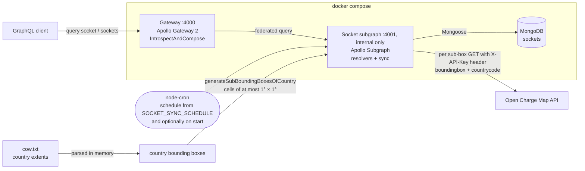

# EV Charging Federated GraphQL

[](https://github.com/the-vishal-kumar/ev-charging-federated-graphql/actions/workflows/ci.yml)
[](./LICENSE)

An ingestion service and a federated GraphQL API for EV charging stations. It
pre-fetches station data from the [Open Charge Map API], writes a change only
when the upstream record has changed, and serves the result through an Apollo
Federation 2 gateway with relay-style pagination. It is built in [NodeJs] and
[TypeScript] without a web framework, and each service has its own Docker image.

## Problem

- **Pull** current charging-station data (`operatorInfo`, `statusType`,
  `addressInfo`, `connections`) from the [Open Charge Map API] and persist it
  in [MongoDB].
- **Write only on change.** A re-import must not rewrite unchanged records.
- Use **UUID v4** identifiers rather than relying only on Mongo ObjectIds.
- Expose the data through **[Federated GraphQL]** (a gateway plus subgraphs),
  with **[relay-style pagination]**.
- Give every service its own Docker image (it targets Kubernetes), run the
  whole system locally with one command, and use no Node.js framework.

The catch: the Open Charge Map `poi` endpoint **has no pagination**. It caps
results per call (`maxresults`) and filters only by country, polygon or
bounding box. So "import everything" has to be designed, not just called.

Full statement: [PROBLEM.md](./PROBLEM.md).

## Quick start

Requires Docker Engine with the compose plugin. Node.js is not needed on the host.

```bash
git clone https://github.com/the-vishal-kumar/ev-charging-federated-graphql.git
cd ev-charging-federated-graphql
make up      # copies .env.sample to .env if missing, builds, waits for health
make seed    # optional: loads 11 sample stations from test/fixtures/sockets.jsonl (no API key needed)
```

Query the gateway:

```bash
curl -s http://localhost:4000/ \
  -H 'content-type: application/json' \
  -d '{"query":"{ sockets(first: 2) { totalCount pageInfo { hasNextPage endCursor } edges { cursor node { identifier uuid serial } } } }"}'
```

The local stack runs with `NODE_ENV=development`, so opening http://localhost:4000
in a browser serves Apollo Sandbox. Stop the stack with `make down` (the data volume is kept).

To sync real data, put an Open Charge Map key in `.env` as
`OPEN_CHARGE_MAP_API_KEY` and run `make up` again. Without a key the stack
still starts and serves whatever is stored; only the sync is disabled.

### Make targets

Every target runs in containers.

| Target | What it does |
| --- | --- |
| `make help` | List targets |
| `make install` | `npm ci` (all workspaces) |
| `make lint` | Prettier check and ESLint |
| `make typecheck` | `tsc --noEmit` over both services and the tests |
| `make build` | Compile both services (`src/gateway/build`, `src/subgraphs/socket/build`) |
| `make test` | Unit and e2e tests with coverage against a throwaway MongoDB |
| `make up` | Start gateway, socket subgraph and MongoDB; GraphQL on http://localhost:4000 |
| `make seed` | Load the sample stations into the running stack (no API key needed) |
| `make logs` | Follow the stack's logs |
| `make down` | Stop the stack (data volume kept; `docker compose down -v` drops it) |
| `make image` | Build both production images |
| `make scan` | Fail on fixable HIGH/CRITICAL CVEs in either image (Trivy) |

## Configuration

Secrets come only from the environment. `.env` is git-ignored; the committed
`.env.sample` and `.env.test` hold no keys.

| Variable | Default | Used by | Meaning |
| --- | --- | --- | --- |
| `OPEN_CHARGE_MAP_API_KEY` | empty | socket | Open Charge Map key, sent in the `X-API-Key` header. Empty disables the sync; queries still work |
| `OPEN_CHARGE_MAP_BASE_URL` | `https://api.openchargemap.io/v3` | socket | Base URL of the Open Charge Map API |
| `SOCKET_SYNC_SCHEDULE` | `1 0 * * *` | socket | Cron expression for the sync (daily at 00:01); validated at start-up |
| `SOCKET_SYNC_ON_START` | `true` | socket | Also sync once at start-up; only the value `false` turns it off |
| `SOCKET_SYNC_COUNTRIES` | `DE,IN` | socket | Comma-separated ISO 3166-1 alpha-2 codes to sync; supported: `DE`, `IN` |
| `MONGO_URI` | none (required) | socket | MongoDB connection string. Compose sets `mongodb://mongo:27017/ev_charging` |
| `PORT` | `4001` (socket), `4000` (gateway) | both | Listen port inside the container. Compose sets 4000 and 4001 |
| `SOCKET_SUBGRAPH_URL` | `http://localhost:4001/` | gateway | Where the gateway reaches the socket subgraph. Compose sets `http://socket:4001/` |
| `GATEWAY_PORT` | `4000` | compose | Host port published for the gateway |
| `NODE_ENV` | `production` in the images; `development` in `compose.yaml` | both | Introspection and Apollo Sandbox are on unless this is `production` |
| `NEW_RELIC_LICENSE_KEY` | empty | both | New Relic APM is loaded only when this is set |
| `NEW_RELIC_APP_NAME` | `ev-charging-federated-graphql` | both | Application name; compose appends `-gateway` or `-socket` |

## Design



Only the gateway publishes a port to the host. The subgraph is reachable on
the compose network only.

**Ingestion (socket subgraph, `cron/pullSocket.ts`)**

1. Country extents come from the public *Countries of the World* dataset
   (`cow.txt`). It is parsed in memory at the start of each sync into each
   country's top-left and bottom-right corner; no generated file is involved.
2. Each enabled country (`SOCKET_SYNC_COUNTRIES`, default `DE` and `IN`) is
   split into a grid of sub-boxes of at most 1 square degree, which is roughly
   70-110 km a side at these latitudes. (Comments in the code say "km²", but
   the arithmetic is in degrees.) Each sub-box becomes one Open Charge Map
   request (`boundingbox`, `countrycode`, `maxresults=1000`). This turns an
   unpaginated API into many smaller, bounded calls.
3. For each response, existing documents are looked up by `serial` (the Open
   Charge Map id). A record is queued only if it is new, or if its
   `dateLastStatusUpdate` is newer than the stored one.
4. Queued records are written with a single `bulkWrite` of `updateOne` +
   `upsert` operations for that sub-box. Updates never touch `_id` or `uuid`.
5. The sync runs on the configured cron schedule (default daily at 00:01) and,
   unless `SOCKET_SYNC_ON_START=false`, once at start-up. Runs do not overlap.
   A failed request is logged and counted, and the sync continues.

**Serving (gateway + subgraph)**

- The socket subgraph publishes a Federation 2 schema (`buildSubgraphSchema`)
  with two queries: `socket(identifier)` and `sockets(first, after, last,
  before)`. `Socket` is a federation entity (`@key(fields: "identifier")`), so
  other subgraphs can extend it.
- `sockets` returns a relay connection (`edges`, `cursor`, `pageInfo`,
  `totalCount`). The cursor is the document `_id`, the order is `_id`
  ascending, and page size is clamped to 1-100 (default 10).
- Each station also carries a `uuid` (v4, unique index).
- The gateway composes the supergraph at start-up by introspecting the
  subgraph (`IntrospectAndCompose`) and exposes one GraphQL endpoint.

**Correctness notes**

- The v4 `uuid` is now assigned on insert with `$setOnInsert`. Previously it
  was never set, so a second new station collided on the unique index.
- UUIDs and ObjectIds are always serialised as strings (Mongoose 9 returns
  bson UUID objects).
- The API key moved from the URL query to the `X-API-Key` header, and the
  missing-key check was fixed.
- Malformed ids and cursors return `NOT_FOUND` / `BAD_USER_INPUT` instead of
  Mongoose cast errors.
- `Socket` is a federation entity.

More detail, including the alternatives considered: [SOLUTION.md](./SOLUTION.md).

## Trade-offs

| Decision | Why | Cost / what would change at scale |
| --- | --- | --- |
| **Pre-fetch the world in bounding-box cells** instead of calling Open Charge Map per user request | Queries never depend on an external API being up; coverage doesn't depend on where users happen to be | Data is up to a day stale; the grid makes many requests even over empty areas (sea, desert) |
| **Change detection on `dateLastStatusUpdate`** | One indexed lookup per batch; no deep diff of nested documents | An upstream edit that doesn't bump that timestamp is missed. A content hash per record would be stricter |
| **Sequential requests, one `bulkWrite` per cell** | Gentle on a free public API; each write is bounded and idempotent (upsert by `serial`) | A full sync is slow. There is no retry/back-off yet; a failed cell is logged and picked up on the next run |
| **Fixed 1° × 1° cells** | A simple, deterministic grid: on the order of a thousand calls cover both countries | A dense cell (a German metro area, say) can exceed `maxresults=1000`, and the excess is silently dropped. Adaptive splitting (split any cell that returns the cap) or smaller cells would fix this |
| **`IntrospectAndCompose` at the gateway** | Zero extra infrastructure for a single subgraph | It isn't meant for production: a subgraph that starts late breaks composition. Production would use a pre-composed supergraph (Rover) or a schema registry |
| **`_id` as the pagination cursor** | Stable and indexed, so no offset scans | Cursors are opaque but not encoded. `totalCount` counts the window after the `after` cursor (or before the `before` cursor), not the whole collection; this is kept for compatibility |
| **One subgraph today** | Federation is in place so new domains (operators, pricing, availability) can be added as separate subgraphs without touching clients | Federation adds a hop and a gateway to run, which is overhead for one domain |
| **Current stack: Node 22 LTS, Apollo Server 5, `@apollo/gateway` 2, Mongoose 9** | Supported versions with current security fixes | Major upgrades changed behaviour (for example Mongoose 9 returns bson UUID objects), which is why serialisation is explicit and tested |
| **`@graphql-tools/utils` npm override to `^12.1.0`** | Apollo Server 5.5.2 caps this package below 12.0.2 only to keep Node 20 installs working, and versions up to 12.0.1 carry a HIGH advisory (GHSA-c4qx-w738-7hr3). On Node 22 the patched version is safe | The override forces a version outside the range Apollo declares. Drop it once Apollo widens its range |
| **New Relic is optional** | The agent is loaded only when `NEW_RELIC_LICENSE_KEY` is set, so local runs and tests have no agent | Monitoring is off unless the key is provided |
| **Sync is disabled, not failing, without an API key** | The API still serves stored data (for example the seeded sample) and the stack starts anywhere | A missing key is only visible as a start-up warning in the logs, not as a failed deploy |

## Testing

`make test` runs the unit and e2e suites in containers against a throwaway
MongoDB on tmpfs, with coverage. Nothing is installed on the host.

- **e2e** starts the subgraph and the gateway in-process on ephemeral ports and
  exercises pagination, id and UUID serialisation, `NOT_FOUND` /
  `BAD_USER_INPUT` errors, and the federation `_entities` lookup.
- **Sync** is tested with a stubbed `fetch` (no real API, no key): insert,
  unchanged re-run, update on a newer `dateLastStatusUpdate` (keeping `uuid`
  and `_id`), failed requests, and abort.
- `NODE_OPTIONS=--experimental-vm-modules` is set because the MongoDB driver 7
  uses a dynamic `import()` that Jest's sandbox supports only with that flag.

CI ([`.github/workflows/ci.yml`](./.github/workflows/ci.yml)) runs on every
push and pull request. The `test` job runs `npm ci`, `npm audit` for
production dependencies, Prettier, ESLint, the type check, the build and Jest
with coverage against a MongoDB service. The `image` job builds both images,
starts the stack with `docker compose up --wait`, seeds the fixture, smoke-tests
GraphQL queries through the gateway, checks that shutdown exits 0, and scans
both images with Trivy for fixable HIGH and CRITICAL findings.

## Images

One multi-stage [Dockerfile](./Dockerfile) with two targets, `gateway` and
`socket` (`make image`).

- Dependencies are installed with `npm ci --omit=dev` per workspace, so each
  image carries only its own production dependencies.
- The runtime stage runs as the non-root `node` user. Code is root-owned and
  read-only to the process. npm, npx, corepack and yarn are removed from the
  runtime stage; they were the source of the base image's CVE findings.
- `HEALTHCHECK` posts `{ __typename }` to the service and expects a success.
- On `SIGTERM` or `SIGINT` the process shuts down gracefully: the socket
  subgraph stops the cron task, aborts an in-flight sync, stops the server and
  closes MongoDB, then exits 0; the gateway stops its server and exits 0.

## Layout

```
.
├── Dockerfile               multi-stage, targets: gateway, socket
├── compose.yaml             local stack: gateway, socket, mongo
├── compose.test.yaml        test runner + throwaway mongo (make test)
├── Makefile
├── .env.sample, .env.test   no secrets
├── jest.config.js           projects: unit, e2e
├── src
│   ├── gateway/src          Apollo Gateway (config, app, util, tests)
│   └── subgraphs/socket/src
│       ├── app/             node-server (schema.graphql), mongo-server
│       ├── config/          env.ts, mongo-config.ts, cow.txt
│       ├── cron/            pullSocket.ts (the sync)
│       ├── model/           Mongoose model, OCM-to-document mapping
│       ├── resolver/        Query.socket, Query.sockets, Date scalar
│       ├── type/            TypeScript types and enums
│       ├── util/            bounding-box grid, uuid, logger
│       └── test/            unit and e2e tests
└── test
    ├── e2e/                 supergraph e2e test
    └── fixtures/            sockets.jsonl (11 sample stations)
```

## External services

- [Open Charge Map API]: the registry of charging locations the sync reads
  from, authenticated with the `X-API-Key` header.
- [Countries of the World]: each country is treated as a rectangle enclosing
  its borders, with one coordinate pair per corner. The edge coordinates come
  from [this answer](https://gis.stackexchange.com/a/260612/225830).

## License

[GPL-3.0-or-later](./LICENSE)

Author: [Vishal Kumar](https://www.linkedin.com/in/the-vishal-kumar/)

[NodeJs]: https://nodejs.org/en
[TypeScript]: https://www.typescriptlang.org/
[Federated GraphQL]: https://www.apollographql.com/docs/federation/
[relay-style pagination]: https://www.apollographql.com/docs/technotes/TN0029-relay-style-connections/
[MongoDB]: https://mongodb.com/
[Open Charge Map API]: https://openchargemap.org/site/develop/api#/operations/get-poi
[Countries of the World]: https://web.archive.org/web/20150319012353/http://opengeocode.org/cude/download.php?file=/home/fashions/public_html/opengeocode.org/download/cow.txt
