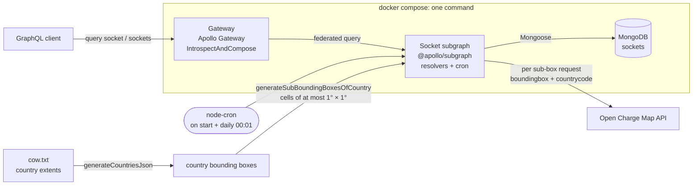

# EV Charging Federated GraphQL

[](./.github/workflows/ci.yml)
[](./LICENSE)

An ingestion service and a federated GraphQL API for EV charging stations. It
pre-fetches station data from the [Open Charge Map API], writes a change only
when the upstream record has changed, and serves the result through an Apollo
Federation 2 gateway with relay-style pagination. It is built in [NodeJs] and
[TypeScript] without a web framework, and each service has its own Docker image.

## Problem

- **Pull** current charging-station data (`operatorInfo`, `statusType`,
  `addressInfo`, `connections`) from the [Open Charge Map API] and persist it
  in [MongoDB].
- **Write only on change.** A re-import must not rewrite unchanged records.
- Use **UUID v4** identifiers rather than relying only on Mongo ObjectIds.
- Expose the data through **[Federated GraphQL]** (a gateway plus subgraphs),
  with **[relay-style pagination]**.
- Give every service its own Docker image (it targets Kubernetes), run the
  whole system locally with one command, and use no Node.js framework.

The catch: the Open Charge Map `poi` endpoint **has no pagination**. It caps
results per call (`maxresults`) and filters only by country, polygon or
bounding box. So "import everything" has to be designed, not just called.

Full statement: [PROBLEM.md](./PROBLEM.md).

## Design



**Ingestion (socket subgraph, `cron/pullSocket.ts`)**

1. Country extents come from the public *Countries of the World* dataset
   (`cow.txt`), which is parsed once into `countries.json` with each country's
   top-left and bottom-right corner.
2. Each enabled country (currently `DE` and `IN`) is split into a grid of
   sub-boxes of at most 1 square degree, which is roughly 70–110 km a side at
   these latitudes. (Comments in the code say "km²", but the arithmetic is in
   degrees.) Each sub-box becomes one Open Charge Map request (`boundingbox`,
   `countrycode`, `maxresults=1000`). This turns an unpaginated API into many
   smaller, bounded calls.
3. For each response, existing documents are looked up by `serial` (the Open
   Charge Map id). A record is queued only if it is new, or if its
   `dateLastStatusUpdate` is newer than the stored one.
4. Queued records are written with a single `bulkWrite` of `updateOne` +
   `upsert` operations for that sub-box.
5. This runs once at start-up and then daily at 00:01 (`node-cron`).

**Serving (gateway + subgraph)**

- The socket subgraph publishes a Federation 2 schema (`buildSubgraphSchema`)
  with two queries: `socket(identifier)` and `sockets(first, after, last,
  before)`.
- `sockets` returns a relay connection (`edges`, `cursor`, `pageInfo`,
  `totalCount`). The cursor is the document `_id`, the order is `_id`
  ascending, and page size is clamped to 1–100.
- Each station also carries a `uuid` (Mongoose `UUID` type, unique index).
- The gateway composes the supergraph at start-up by introspecting the
  subgraphs (`IntrospectAndCompose`) and exposes one GraphQL endpoint.

More detail, including the alternatives considered: [SOLUTION.md](./SOLUTION.md).

## Trade-offs

| Decision | Why | Cost / what would change at scale |
| --- | --- | --- |
| **Pre-fetch the world in bounding-box cells** instead of calling Open Charge Map per user request | Queries never depend on an external API being up; coverage doesn't depend on where users happen to be | Data is up to a day stale; the grid makes many requests even over empty areas (sea, desert) |
| **Change detection on `dateLastStatusUpdate`** | One indexed lookup per batch; no deep diff of nested documents | An upstream edit that doesn't bump that timestamp is missed. A content hash per record would be stricter |
| **Sequential requests, one `bulkWrite` per cell** | Gentle on a free public API; each write is bounded and idempotent (upsert by `serial`) | A full sync is slow. There is no retry/back-off yet; a failed cell is logged and picked up on the next run |
| **Fixed 1° × 1° cells** | A simple, deterministic grid: on the order of a thousand calls cover both countries | A dense cell (a German metro area, say) can exceed `maxresults=1000`, and the excess is silently dropped. Adaptive splitting (split any cell that returns the cap) or smaller cells would fix this |
| **`IntrospectAndCompose` at the gateway** | Zero extra infrastructure for a single subgraph | It isn't meant for production: a subgraph that starts late breaks composition. Production would use a pre-composed supergraph (Rover) or a schema registry |
| **`_id` as the pagination cursor** | Stable and indexed, so no offset scans | Cursors are opaque but not encoded. `totalCount` counts the remaining window after the cursor, not the whole collection |
| **One subgraph today** | Federation is in place so new domains (operators, pricing, availability) can be added as separate subgraphs without touching clients | Federation adds a hop and a gateway to run, which is overhead for one domain |
| **Apollo Server 3, Node 18** | Current when this was written (June 2023) | Both are now end-of-life |

## Initial setup

1.  Clone from GitHub

    ```bash
    git clone https://github.com/the-vishal-kumar/nodejs-typescript-federated-graphql-boilerplate.git
    ```

1.  Setup [Docker] and [Docker-Compose]

    -   Install `docker` and `docker-compose` on your machine
    -   Copy `docker-compose.sample.yml` as `docker-compose.yml`

1.  Install dependencies using npm

    ```bash
    cd nodejs-typescript-federated-graphql-boilerplate
    npm i
    ```

1.  Set environment variables

    -   Copy `.env.sample` to the root directory as `.env`.

        -   Put the value of `OPEN_CHARGE_MAP_API_KEY`.

            -   Leaving it empty won't prevent the application from starting/running, but the polling won't work.
            -   The application will be able to serve queries from already polled data (which will be empty if the application is started without a key).

        -   (Optional) Put the value of `NEW_RELIC_LICENSE_KEY`. Generate a key from [here](https://docs.newrelic.com/docs/apm/agents/nodejs-agent/getting-started/introduction-new-relic-nodejs/).

## Development

1.  Execute the command from the root directory to start the application

    ```bash
    npm start
    ```

## Testing

1.  Some end-to-end and unit tests are included in `src/test` directory for the socket subgraph
2.  Tests are run using [Jest]
3.  Execute the command from the root directory to run the tests

    ```bash
    npm test
    ```

4.  CI ([`.github/workflows/ci.yml`](./.github/workflows/ci.yml)) runs on every push and pull request. One job checks Prettier and ESLint and type-checks both services. The other starts the same Docker test stack (seeded MongoDB, subgraph, gateway) and runs Jest with coverage, then uploads the coverage report as an artifact. The workflow token is read-only.

## API Documentation

1.  Import Postman collection and environment variable
    -   Import Collection from [here](https://www.postman.com/descent-module-operator-65787222/workspace/public/collection/649289bd3516b12300f37753).
    -   Import Environment Variables from [here](https://www.postman.com/descent-module-operator-65787222/workspace/public/environment/15813424-cdf6a24c-f88e-4315-87ae-665d692a46ce).

## Technology

-   Language - [NodeJs] | [TypeScript]
-   [GraphQL] | [Federated GraphQL]
-   [MongoDB]
-   Containerization Software - [Docker] | [Docker-Compose]
-   Version Control - [Git](https://git-scm.com/book/en/v2/Getting-Started-Installing-Git)

## Code Quality

-   [ESLint]
-   [Prettier]
-   [CommitLint]

## Code Review

-   A feature branch is created from the *dev* branch, and after completion of the code, a PR is generated for the _dev_ branch
-   If changes are requested by a reviewer on Github, then the person who has made the PR makes appropriate changes. The reviewer reviews again and marks the comments as resolved
-   If there are no new changes required, then PR is merged with the *dev* branch

## Managing Credentials

-   Credentials live in the `.env` file

## Git Workflow

-   A branch is created for each ticket from the *dev* branch

-   Example of Branch Name:

    -   feature/{ticket_number}
    -   bugfix/{ticket_number}
    -   hotfix/{ticket_number}
    -   dev
    -   staging
    -   master

-   Read the next section for more information

<!--
## CI and Deployment

- Auto deployment is triggered on Heroku CI itself when code is pushed to respective branches. If all the test cases (feature, unit, postman, http, console etc.) don't pass, then the build won't be deployed
- On pushing the code to the `dev` branch, test cases will run. On passing all the tests, the build
  will deploy on the `Development` environment
- On pushing the code to the `staging` branch, test cases will run. On passing all the tests, the build will deploy on the `Staging` environment
- On pushing the code to the `master` branch, test cases will run. On passing all the tests, the build will deploy on the `Production` environment
-->

## Error Logging

-   [New Relic]

## Application Performance Monitoring

-   [New Relic]

## Log Monitoring

-   [New Relic]

<!---
## Backups

- Database backups are made every 24 hours at 2100 hours UTC time by Heroku for Staging and Production environment
-->

## Folder Structure

        📦nodejs-typescript-federated-graphql-boilerplate
        ┣ 📂.github
        ┃ ┗ 📂workflows
        ┃ ┃ ┗ 📜ci.yml
        ┣ 📂.husky
        ┃ ┣ 📂_
        ┃ ┃ ┣ 📜.gitignore
        ┃ ┃ ┗ 📜husky.sh
        ┃ ┣ 📜commit-msg
        ┃ ┣ 📜pre-commit
        ┃ ┗ 📜pre-push
        ┣ 📂src
        ┃ ┣ 📂database-test
        ┃ ┃ ┣ 📜Dockerfile
        ┃ ┃ ┗ 📜sockets.seed.data
        ┃ ┣ 📂gateway
        ┃ ┃ ┣ 📂src
        ┃ ┃ ┃ ┣ 📂test
        ┃ ┃ ┃ ┃ ┗ 📂unit
        ┃ ┃ ┃ ┃ ┃ ┗ 📂util
        ┃ ┃ ┃ ┃ ┃ ┃ ┗ 📜logger.unit.test.ts
        ┃ ┃ ┃ ┣ 📂util
        ┃ ┃ ┃ ┃ ┣ 📜index.ts
        ┃ ┃ ┃ ┃ ┗ 📜logger.ts
        ┃ ┃ ┃ ┗ 📜index.ts
        ┃ ┃ ┣ 📜.nvmrc
        ┃ ┃ ┣ 📜Dockerfile
        ┃ ┃ ┣ 📜newrelic.js
        ┃ ┃ ┣ 📜package.json
        ┃ ┃ ┗ 📜tsconfig.json
        ┃ ┗ 📂subgraphs
        ┃ ┃ ┗ 📂socket
        ┃ ┃ ┃ ┣ 📂src
        ┃ ┃ ┃ ┃ ┣ 📂app
        ┃ ┃ ┃ ┃ ┃ ┣ 📂mongo-server
        ┃ ┃ ┃ ┃ ┃ ┃ ┗ 📜index.ts
        ┃ ┃ ┃ ┃ ┃ ┣ 📂node-server
        ┃ ┃ ┃ ┃ ┃ ┃ ┣ 📜index.ts
        ┃ ┃ ┃ ┃ ┃ ┃ ┗ 📜schema.graphql
        ┃ ┃ ┃ ┃ ┃ ┗ 📜index.ts
        ┃ ┃ ┃ ┃ ┣ 📂config
        ┃ ┃ ┃ ┃ ┃ ┣ 📜countries.json
        ┃ ┃ ┃ ┃ ┃ ┣ 📜cow.txt
        ┃ ┃ ┃ ┃ ┃ ┣ 📜index.ts
        ┃ ┃ ┃ ┃ ┃ ┗ 📜mongo-config.ts
        ┃ ┃ ┃ ┃ ┣ 📂cron
        ┃ ┃ ┃ ┃ ┃ ┣ 📜index.ts
        ┃ ┃ ┃ ┃ ┃ ┗ 📜pullSocket.ts
        ┃ ┃ ┃ ┃ ┣ 📂middleware
        ┃ ┃ ┃ ┃ ┣ 📂model
        ┃ ┃ ┃ ┃ ┃ ┣ 📜index.ts
        ┃ ┃ ┃ ┃ ┃ ┗ 📜socket.ts
        ┃ ┃ ┃ ┃ ┣ 📂resolver
        ┃ ┃ ┃ ┃ ┃ ┣ 📂query
        ┃ ┃ ┃ ┃ ┃ ┃ ┣ 📜index.ts
        ┃ ┃ ┃ ┃ ┃ ┃ ┣ 📜socket.ts
        ┃ ┃ ┃ ┃ ┃ ┃ ┗ 📜sockets.ts
        ┃ ┃ ┃ ┃ ┃ ┗ 📜index.ts
        ┃ ┃ ┃ ┃ ┣ 📂test
        ┃ ┃ ┃ ┃ ┃ ┣ 📂e2e
        ┃ ┃ ┃ ┃ ┃ ┃ ┗ 📂resolver
        ┃ ┃ ┃ ┃ ┃ ┃ ┃ ┗ 📂query
        ┃ ┃ ┃ ┃ ┃ ┃ ┃ ┃ ┣ 📜socket.e2e.test.ts
        ┃ ┃ ┃ ┃ ┃ ┃ ┃ ┃ ┗ 📜sockets.e2e.test.ts
        ┃ ┃ ┃ ┃ ┃ ┗ 📂unit
        ┃ ┃ ┃ ┃ ┃ ┃ ┗ 📂util
        ┃ ┃ ┃ ┃ ┃ ┃ ┃ ┣ 📜array.unit.test.ts
        ┃ ┃ ┃ ┃ ┃ ┃ ┃ ┣ 📜enum.unit.test.ts
        ┃ ┃ ┃ ┃ ┃ ┃ ┃ ┣ 📜generateCountriesJson.unit.test.ts
        ┃ ┃ ┃ ┃ ┃ ┃ ┃ ┣ 📜generateSubBoundingBoxesOfCountry.unit.test.ts
        ┃ ┃ ┃ ┃ ┃ ┃ ┃ ┗ 📜logger.unit.test.ts
        ┃ ┃ ┃ ┃ ┣ 📂type
        ┃ ┃ ┃ ┃ ┃ ┣ 📂config
        ┃ ┃ ┃ ┃ ┃ ┃ ┣ 📜country.ts
        ┃ ┃ ┃ ┃ ┃ ┃ ┗ 📜index.ts
        ┃ ┃ ┃ ┃ ┃ ┣ 📂model
        ┃ ┃ ┃ ┃ ┃ ┃ ┣ 📜index.ts
        ┃ ┃ ┃ ┃ ┃ ┃ ┗ 📜socket.ts
        ┃ ┃ ┃ ┃ ┃ ┣ 📂resolver
        ┃ ┃ ┃ ┃ ┃ ┃ ┣ 📂query
        ┃ ┃ ┃ ┃ ┃ ┃ ┃ ┣ 📜index.ts
        ┃ ┃ ┃ ┃ ┃ ┃ ┃ ┗ 📜sockets.ts
        ┃ ┃ ┃ ┃ ┃ ┃ ┗ 📜index.ts
        ┃ ┃ ┃ ┃ ┃ ┗ 📜index.ts
        ┃ ┃ ┃ ┃ ┣ 📂util
        ┃ ┃ ┃ ┃ ┃ ┣ 📜array.ts
        ┃ ┃ ┃ ┃ ┃ ┣ 📜enum.ts
        ┃ ┃ ┃ ┃ ┃ ┣ 📜generateCountriesJson.ts
        ┃ ┃ ┃ ┃ ┃ ┣ 📜generateSubBoundingBoxesOfCountry.ts
        ┃ ┃ ┃ ┃ ┃ ┣ 📜index.ts
        ┃ ┃ ┃ ┃ ┃ ┗ 📜logger.ts
        ┃ ┃ ┃ ┃ ┗ 📜index.ts
        ┃ ┃ ┃ ┣ 📜.nvmrc
        ┃ ┃ ┃ ┣ 📜Dockerfile
        ┃ ┃ ┃ ┣ 📜newrelic.js
        ┃ ┃ ┃ ┣ 📜package.json
        ┃ ┃ ┃ ┗ 📜tsconfig.json
        ┣ 📜.commitlintrc.json
        ┣ 📜.dockerignore
        ┣ 📜.env
        ┣ 📜.env.sample
        ┣ 📜.env.test
        ┣ 📜.eslintrc.json
        ┣ 📜.gitignore
        ┣ 📜.nvmrc
        ┣ 📜.prettierrc.json
        ┣ 📜LICENSE
        ┣ 📜PROBLEM.md
        ┣ 📜README.md
        ┣ 📜SOLUTION.md
        ┣ 📜docker-compose.sample.yml
        ┣ 📜docker-compose.test.yml
        ┣ 📜docker-compose.yml
        ┣ 📜jest.config.js
        ┣ 📜package-lock.json
        ┣ 📜package.json
        ┗ 📜tsconfig.json

## External Services/API Reference

-   [Open Charge Map API]

    -   The Open Charge Map API provides access to the world's largest registry of charging locations as Open Data.

-   [Countries of the World]

    -   The solution involves conceptualizing each country as a small rectangle, encompassing all of its borders, and representing each corner of the rectangle with coordinates.

    -   The data for edge coordinates was obtained from [here](https://gis.stackexchange.com/a/260612/225830) where I reached through this [stack exchange answer](https://gis.stackexchange.com/a/260612/225830).

## License

-   [GPL-3.0-or-later](./LICENSE)

## Meet The Maker

[Vishal Kumar] - Software Engineer 👨‍💻 and an Aspiring Entrepreneur👨‍💼

[vishal kumar]: https://www.linkedin.com/in/the-vishal-kumar/

[NodeJs]: https://nodejs.org/en
[TypeScript]: https://www.typescriptlang.org/
[Graphql]: https://graphql.org/
[Federated Graphql]: https://www.apollographql.com/docs/federation/
[relay-style pagination]: https://www.apollographql.com/docs/technotes/TN0029-relay-style-connections/
[MongoDB]: https://mongodb.com/
[Mongoose]: https://mongoosejs.com/
[Docker]: https://www.docker.com/
[Docker-Compose]: https://docs.docker.com/compose/
[ESLint]: https://eslint.org/
[Prettier]: https://prettier.io/
[CommitLint]: https://commitlint.js.org/
[Husky]: https://typicode.github.io/husky/
[Jest]: https://jestjs.io/
[Heroku]: https://www.heroku.com/
[Winston]: https://github.com/winstonjs/winston
[New Relic]: https://newrelic.com
[Postman]: https://postman.com/
[Git]: https://git-scm.com/book/en/v2/Getting-Started-Installing-Git
[Open Charge Map API]: https://openchargemap.org/site/develop/api#/operations/get-poi
[Countries of the World]: https://web.archive.org/web/20150319012353/http://opengeocode.org/cude/download.php?file=/home/fashions/public_html/opengeocode.org/download/cow.txt